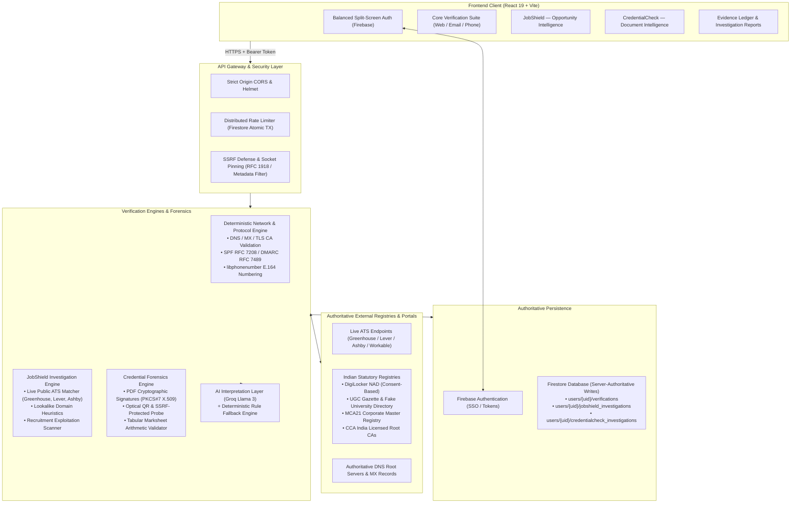

<div align="center">
  <h1>VerifyMe</h1>
  <p><strong>Autonomous Digital Trust, Opportunity Intelligence & Document Verification Platform</strong></p>
  
  [](https://reactjs.org/)
  [](https://nodejs.org/)
  [](https://expressjs.com/)
  [](https://firebase.google.com/)
  [](https://groq.com/)
  [](#-design-system--visual-identity)
  [](https://netlify.com/)
</div>

<br />

**VerifyMe** is an enterprise-grade digital trust and verification intelligence platform engineered to investigate digital entities (Phone Numbers, Email Addresses, Website URLs), recruitment communications (JobShield), and academic/corporate credentials (CredentialCheck) before trusting, sharing, or responding.

VerifyMe couples **standards-compliant deterministic protocol inspection** (DNS, TLS, RFC 7208 SPF, RFC 7489 DMARC, E.164 telecom plans, PDF byte-range signatures, and SSRF filters) with an **AI explanation layer** (powered by Groq Llama 3) backed by an instantaneous fail-safe deterministic fallback engine.

---

## 🏛️ System Architecture

VerifyMe is architected as a secure, distributed monorepo featuring a decoupled single-page application (SPA) client, a high-throughput Express / Netlify Functions API, serverless micro-adapters, and backend-authoritative persistence.



### Architectural Highlights
1. **Decoupled Client & Serverless Readiness:** Runs identically as a long-running Node/Express server (`server.js`) or an event-driven Netlify Serverless Function (`netlify/functions/api.js`).
2. **Backend-Authoritative Security:** All scores, risk classifications, and case files are computed on the backend. Browser clients have strictly read-only access to Firestore data (`allow write: if false;`), preventing client-side score forgery.
3. **Comprehensive SSRF Protection:** Pre-flight DNS resolution, private/internal IP filtering (IPv4/IPv6 loopback, RFC 1918, RFC 5737, cloud metadata `169.254.169.254`), and socket pinning prevent TOCTOU DNS rebinding during external live probes.
4. **Three-Dimensional Scoring:** Technical validity, reputation, and evidence completeness are decoupled, preventing legitimate infrastructure from suffering artificial score dampening.

---

## 💎 Core Product Modules

### 1. Core Verification Suite — Evidence Ledger
* **Modalities:** Phone Numbers, Email Addresses, and Website URLs.
* **Evidence Ledger Report:** Completely reimagined verification report featuring editorial typography, asymmetric layout, verdict-first primary anchor, dimensional telemetry (Technical Health, Reputation, Evidence Completeness), and interactive finding drawers.
* **Deterministic Calibration:** Validated against edge-case benchmarks (`google.com`, `neverssl.com`, `+919876543210`, `test@gmail.com`).

### 2. JobShield — Opportunity Intelligence
* **Purpose:** Investigates job postings, recruiter communications, and offer letters for exploitation indicators and employment fraud.
* **4-Way Intake Workspace:**
  1. **Email / Message:** Direct text intake with quick sample presets (`Suspicious Offer Sample` and `Legitimate Corporate Offer`).
  2. **PDF Offer Letter:** Drag-and-drop parser with size/format validation.
  3. **Screenshot:** PNG, JPEG, WebP recruitment screenshot analysis.
  4. **Job Posting URL:** Automatic live ATS endpoint matching across Greenhouse, Lever, Ashby, and Workable.
* **Opportunity Intelligence Report:** Verdict-first layout (`VERIFIED OPPORTUNITY`, `LIKELY LEGITIMATE`, `SUSPICIOUS INCONSISTENCIES`, `HIGH RISK DETECTED`, `INSUFFICIENT EVIDENCE`), opportunity profile grid, compact summary metrics, categorized findings, action advisory, and collapsible technical diagnostics.

### 3. CredentialCheck — Document Intelligence
* **Purpose:** Audits educational certificates, marksheet calculations, internship letters, and experience credentials for issuer authenticity and tampering.
* **Intake & Category Selection:**
  - 7 Supported Categories: Auto-detect, Internship, Course Completion, Training, Experience Letter, Academic Degree / Marksheet, Professional Certification.
  - Expandable optional details accordion with non-corroboration disclaimers.
  - Candidate consent verification under the IT Act (2000) and DPDP Act.
* **Document Intelligence Report:**
  - Answers the 5 core questions: *What was investigated? What was established? What remains unverified? Were contradictions found? What should the user do next?*
  - Four investigation dimensions: Issuer Identity, Document Integrity, Credential Issuance, and Claim Consistency.
  - 9-parameter extracted credential grid with explicit origin labeling (`Extracted from document` vs. `Provided by you`) and independent verification state (`Matched`, `Mismatched`, `Unverified`).
  - Statutorily grounded against DigiLocker NAD, UGC Gazette, MCA21, and CCA India Licensed CAs.

### 4. Authentication & User Workspace
* **Design:** Balanced Split-Screen layout with branded digital trust illustration and charcoal forms.
* **Auth Providers:** Firebase Authentication supporting Email/Password and one-click Google OAuth SSO.
* **State & Navigation:** Responsive session handling, protected routes, case dossier export, and case history management.

---

## 🎨 Design System & Visual Identity

VerifyMe adheres to a custom **Fresh Mint + White** design system designed to convey calm authority, technical credibility, and digital safety without dark cybersecurity tropes:

| Token | Hex Value | Application |
| :--- | :--- | :--- |
| **Main Background** | `#FAFCFA` | Application-wide viewport background |
| **Primary Surface** | `#FFFFFF` | Workspace cards, dossier sheets, navigation shell |
| **Primary Mint** | `#49B99A` | Primary action buttons, active tabs, brand accents |
| **Deep Mint** | `#2E7D5B` | High-contrast status badges, icon containers, headings |
| **Soft Mint Wash** | `#EFF8F3` | Active pills, verdict banners, badge surfaces |
| **Dark Typography** | `#202923` | Primary headings, table text, case titles |
| **Secondary Text** | `#737D76` | Subtitles, field hints, technical metadata |
| **Borders & Dividers**| `#E7EEE9` | Subtle structural dividers and input outlines |
| **Restrained Status** | Red (`#D94E4E`), Amber (`#B45309`), Mint (`#2E7D5B`) | Contextual findings and verdict rails only |

---

## 💻 Tech Stack

### Frontend Client
- **Framework:** React 19, Vite 8
- **Routing:** React Router DOM 7
- **Styling:** Custom Modular CSS with CSS Variables, Tailwind CSS v4
- **Icons:** Lucide React
- **Authentication:** Firebase Client SDK 12 (Auth & Firestore)
- **Tooling & Quality:** `oxlint` (Zero-warning linting), Vite Production Bundler

### Backend Server & Functions
- **Runtime:** Node.js 18+, Express 4.x
- **Serverless Adapter:** `serverless-http` (Netlify Functions)
- **Security:** Helmet, CORS, Custom SSRF Engine, Firestore Atomic Transaction Rate Limiter
- **Telecom Engine:** `libphonenumber-js`
- **DNS & Network:** Node.js Native Promises DNS with strict timeouts
- **AI Engine:** Groq SDK (`llama-3.3-70b-versatile`) with deterministic fail-safe rule engine

---

## 📁 Repository Structure

```
VerifyMe/
├── client/                               # React 19 Single-Page Application (Vite)
│   ├── firestore.rules                   # Hardened Firestore security rules (read-only client)
│   ├── src/
│   │   ├── assets/                       # Brand visual assets
│   │   ├── components/
│   │   │   ├── auth/                     # VerifyMe custom animated loaders
│   │   │   ├── common/                   # Error boundary and shared primitives
│   │   │   ├── credentialcheck/          # CredentialCheck Document Intelligence workspace
│   │   │   ├── dashboard/                # Main dashboard, workspace & Evidence Ledger
│   │   │   └── jobshield/                # JobShield Opportunity Intelligence workspace
│   │   ├── context/                      # AuthContext (Firebase user state)
│   │   ├── firebase/                     # Firebase Client initialization
│   │   ├── pages/                        # Auth, Dashboard, JobShield, CredentialCheck, History
│   │   ├── routes/                       # Protected route wrappers
│   │   └── services/                     # Typed API clients (Core, JobShield, CredentialCheck)
├── server/                               # Express REST API & Serverless Function backend
│   ├── src/
│   │   ├── config/                       # Firebase Admin SDK & environment configuration
│   │   ├── controllers/                  # Verification, JobShield, Credential & User controllers
│   │   ├── middleware/                   # Auth token validation, rate limiters, SSRF filters
│   │   ├── routes/                       # REST API route definitions
│   │   ├── services/                     # Verification logic, ATS matchers, PDF forensics, Groq AI
│   │   └── utils/                        # Admin seeding & security helpers
│   ├── test/                             # Automated test suite (139+ tests across 10 suites)
│   └── server.js                         # Local Express server entry point
├── netlify/                              # Serverless production functions
└── netlify.toml                          # Monorepo build and redirection configuration
```

---

## 🧪 Testing & Quality Assurance

VerifyMe includes comprehensive automated unit, integration, and security tests:

```bash
# Run backend test suite
cd server
npm test
```

### Automated Linter & Production Build
```bash
# Verify client linting and compilation
cd client
npx oxlint src/
npm run build
```

---

## ⚙️ Local Development Setup

### 1. Prerequisites
- **Node.js** v18 or higher
- A **Firebase Project** with Authentication and Firestore enabled
- A **Groq Cloud API Key** (optional: deterministic fallback operates automatically if omitted)

### 2. Environment Variables

Create `server/.env`:
```env
PORT=5000
NODE_ENV=development
ALLOWED_ORIGINS=http://localhost:5173,http://localhost:5174,http://localhost:3000
FIREBASE_PROJECT_ID=your_firebase_project_id

# Optional for live AI interpretation
GROQ_API_KEY=your_groq_api_key
GROQ_MODEL=llama-3.3-70b-versatile

# Firebase Service Account (JSON string or path)
# FIREBASE_SERVICE_ACCOUNT={"type":"service_account",...}
```

Create `client/.env`:
```env
VITE_API_URL=http://localhost:5000/api
VITE_FIREBASE_API_KEY=your_firebase_api_key
VITE_FIREBASE_AUTH_DOMAIN=your_project.firebaseapp.com
VITE_FIREBASE_PROJECT_ID=your_project_id
VITE_FIREBASE_STORAGE_BUCKET=your_project.appspot.com
VITE_FIREBASE_MESSAGING_SENDER_ID=your_sender_id
VITE_FIREBASE_APP_ID=your_app_id
```

### 3. Installation & Startup

```bash
# Install all dependencies across monorepo
npm run install:all

# Run backend development server (Port 5000)
cd server
npm run dev

# In a separate terminal, run frontend client (Port 5173/5174)
cd client
npm run dev
```

---

## ☁️ Deployment

VerifyMe is preconfigured for zero-config continuous deployment on **Netlify**:
1. Connect the GitHub repository to Netlify.
2. The root `netlify.toml` automatically builds the React 19 client (`cd client && npm run build`) and mounts `/api/*` to the serverless function (`netlify/functions/api.js`).
3. Set your production environment variables in the Netlify Dashboard (`ALLOWED_ORIGINS`, `FIREBASE_PROJECT_ID`, `FIREBASE_SERVICE_ACCOUNT`, `GROQ_API_KEY`, and `VITE_FIREBASE_*`).

---

<div align="center">
  <sub>VerifyMe • Engineered for technical precision, defensible credibility, and uncompromising digital trust.</sub>
</div>
